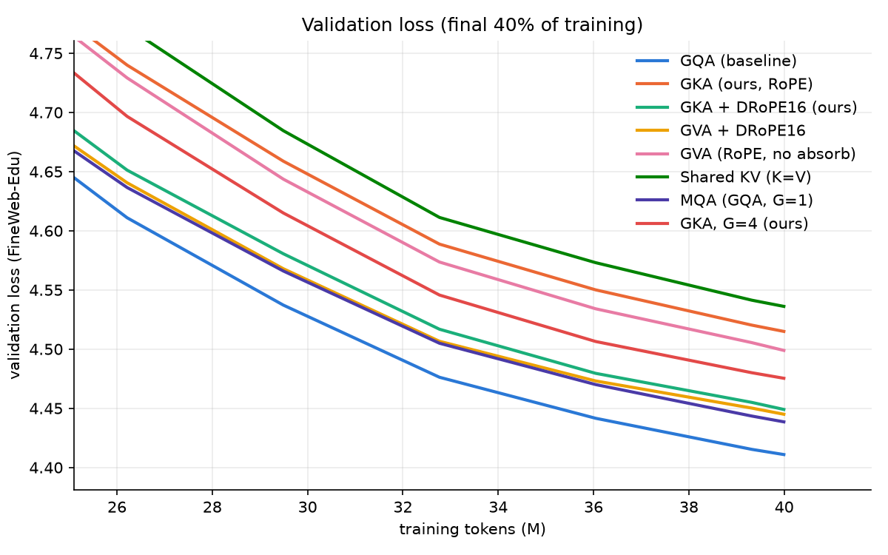

# GKA: Grouped Key Attention

GKA mirrors Grouped Value Attention (GVA; Tripathi, Kumar & Khan, FrontiersMind). GVA caches grouped **values** and rebuilds per-head keys. GKA caches grouped **keys** and rebuilds per-head values:

| | cached content | reconstructed | absorbed at decode into |
|---|---|---|---|
| GQA | K_g (rotated), V_g | — | — |
| GVA | V_g | K_h = V_g M_h | the query: q̃_h = q_h M_hᵀ |
| **GKA** | **K_g (unrotated)** | **V_h = K_g N_h** | **the output projection: W_O' = blockdiag(N_h) W_O** |

## Why GKA is interesting: RoPE does not break the absorption

In GVA, M_h sits between the two RoPE rotations, `q R_{j−t} M_hᵀ v_jᵀ`, so it cannot be folded into the query. GVA therefore needs a *decoupled* RoPE slice. That slice costs an extra cache stream of width d_r plus extra query width.

In GKA the reconstruction happens on the **value** side, after the softmax:

```
o_t = Σ_h softmax_j( q_t R_t (k_{j,g} R_j)ᵀ / √d ) · k_{j,g} N_h W_O^h
                    └─ score: rotate cached K on the fly ─┘   └ absorbed ┘
```

The cache stores the *unrotated* grouped key. At decode time it is rotated elementwise for scoring, a free op inside a fused kernel. The same unrotated key multiplies the attention weights, and `N_h W_O^h` is a fixed matrix. So GKA keeps **ordinary RoPE**, needs **no decoupled slice**, and its cache is **exactly 50%** of GQA's. With the decoupled-RoPE variant (`gka_drope`) its cache is identical in size to GVA+DRoPE.

## An honest observation: expressivity

Because `N_h W_O^h` collapses into a single matrix, GKA spans the same function class as "Shared KV with values = unrotated keys" plus a per-head output projection. The paper's failed "Shared KV" (K = V) baseline is exactly that function class. Likewise, with decoupled RoPE, GVA's `W_Q^h M_hᵀ` collapses into a single query projection. Any quality gap between GKA/GVA and Shared KV therefore comes from optimisation dynamics of the factorised parameterisation, not from extra capacity. The only exception is GVA with ordinary RoPE, where M sits between rotations. That is why `sharedkv` is included as a control.

## Variants trained (`gka/model.py`)

| name | description | cache scalars / token / layer (G=2, d_h=64, d_r=16) |
|---|---|---|
| `gqa` | grouped-query baseline | 256 |
| `gka` | **ours**, ordinary RoPE, absorbed decode | 128 (−50%) |
| `gka_drope` | ours + shared decoupled RoPE slice | 144 (−43.75%) |
| `gva_drope` | GVA paper's serving design | 144 (−43.75%) |
| `gva` | GVA with ordinary RoPE (cannot absorb; rebuilds H keys per step) | 128 (−50%) |
| `sharedkv` | K = V control (GVA paper's first cut) | 128 (−50%) |

All maps M/N use the scale-matched init from GVA App. A (σ = 1/√d_h), with no query norm. `tests/test_model.py` checks that the absorbed cached decode path of every variant reproduces the full forward pass (max |Δlogit| ≈ 1e-6 in fp32).

## Setup

* 8 layers, d_model 512, 8 query heads, 2 KV groups, d_h 64, SwiGLU, RMSNorm, tied embeddings, GPT-2 BPE; about 48M params (22.5M non-embedding).
* 40M FineWeb-Edu (sample-10BT) tokens per model, context 512, AdamW (0.9, 0.95), lr 1.5e-3 cosine with 100 warmup steps, wd 0.1, batch 16k tokens, bf16. Data order is identical for every variant.
* Zero-shot eval (lm-eval-harness conventions): HellaSwag, ARC-E/C, OBQA, PIQA, WinoGrande, LAMBADA, plus held-out FineWeb-Edu loss at 512/1024/2048 context (length extrapolation).
* Inference: cache bytes, prefill latency, decode tok/s, and peak memory across batch/context settings, all through each variant's absorbed cached path.

## Repository layout

```
gka/                      the library
  model.py                  all attention variants + absorbed cached decode paths
  runs.py                   run naming (gka_g4, gka_s7, gka_c2048, ...) and checkpoint loading
  style.py                  model labels and plot colours
  paths.py                  data/, runs/, results/, logs/ locations
scripts/                  entry points (run from any directory)
  prepare_data.py           stream + tokenize FineWeb-Edu -> data/{train,val}.bin
  train.py                  train one run -> runs/<name>/
  evaluate.py               zero-shot benchmarks -> runs/<name>/benchmarks.json
  bench_inference.py        cache size / prefill / decode speed -> results/inference.json
  bench_train_throughput.py training tok/s and memory per variant
  analyze.py                tables + plots -> results/results.md, results/figures/
  eval_long_context.py      loss at 512-16k context, plain vs NTK RoPE -> runs/<name>/long_context.json
  analyze_long_context.py   -> results/long_context.md, results/figures/long_context.png
  run_all.ps1, run_all.sh   the whole pipeline, resumable
tests/test_model.py       decode == forward for every variant, cache sizes, run names
runs/<name>/              log.jsonl (training curve), summary.json, benchmarks.json
results/                  results.md, inference.json, figures/
```

Not in git: `data/` (regenerate with `prepare_data.py`), `logs/`, and `runs/*/model.pt` checkpoints (~190 MB each, over GitHub's 100 MB file limit).

## Reproduce

Requires [uv](https://docs.astral.sh/uv/) and an NVIDIA GPU (the lockfile pins PyTorch built for CUDA 12.8). Each training run takes about 40 minutes on an RTX 3050 laptop GPU.

```bash
uv sync
uv run pytest                                   # decode-path equivalence tests (CPU or GPU)

# everything, end to end (resumable; skips finished runs):
bash scripts/run_all.sh                          # or: powershell -File scripts/run_all.ps1

# or step by step:
uv run python scripts/prepare_data.py            # 45M train / 2M val tokens
uv run python scripts/train.py --attn gka        # one run; --n_group 4 -> runs/gka_g4, --seed 7 -> runs/gka_s7,
                                                 #   --seq_len 2048 --micro_bs 8 --accum 1 -> runs/gka_c2048
uv run python scripts/evaluate.py --runs gqa gka # default: all eight runs
uv run python scripts/bench_inference.py
uv run python scripts/analyze.py                 # -> results/results.md + results/figures/
```

## Results

Full tables are in [`results/results.md`](results/results.md). Plots are in `results/figures/`. Two extra equal-cache controls were added: **MQA** (GQA with G=1, the same cache as GKA) and **GKA with G=4** (the same cache as GQA).




### Quality (40M tokens, ~48M params)

GQA, MQA, GKA (RoPE) and GVA+DRoPE were trained with 3 seeds (1337 locally, 1 and 2 on a Colab A100; same data order, different init). Their numbers are means; ± is the std across seeds. The other rows are single runs.

| Method | Seeds | KV cache vs GQA | Val loss ↓ | Val PPL | 6-task avg acc | Extrapolation: loss @2048 ctx ↓ |
|---|---|---|---|---|---|---|
| GQA (G=2) | 3 | 100% | **4.414 ± 0.003** | **82.6** | 34.91 | 5.42 |
| GKA, G=4 (ours) | 1 | 100% | 4.475 | 87.8 | 34.79 | **5.01** |
| GKA + DRoPE16 (ours) | 1 | 56% | 4.449 | 85.5 | 35.08 | 5.52 |
| GVA + DRoPE16 | 3 | 56% | 4.448 ± 0.006 | 85.5 | 34.75 | 5.56 |
| MQA (G=1) | 3 | 50% | **4.434 ± 0.009** | 84.2 | 34.74 | 5.43 |
| GVA, RoPE (no absorb) | 1 | 50% | 4.499 | 89.9 | 34.92 | 5.24 |
| GKA, RoPE (ours) | 3 | 50% | 4.497 ± 0.016 | 89.7 | 34.80 | 5.12 |
| Shared KV (K=V) | 1 | 50% | 4.536 | 93.3 | 34.53 | 5.43 |

Per-seed validation loss for the 3-seed models:

| Method | seed 1337 | seed 1 | seed 2 |
|---|---|---|---|
| GQA | 4.411 | 4.417 | 4.414 |
| MQA | 4.439 | 4.439 | 4.423 |
| GVA + DRoPE16 | 4.445 | 4.445 | 4.456 |
| GKA, RoPE | 4.515 | 4.487 | 4.489 |

The zero-shot benchmarks (HellaSwag, ARC-E/C, OBQA, PIQA, WinoGrande) are all within about 1 point of chance at this scale. Every model lands at 34.7–35.1 on average, inside seed noise, so **validation loss is the metric that discriminates**.

### Inference (RTX 3050 laptop, bf16, PyTorch eager; B=32, T=4096)

| Method | KV cache | decode tok/s | decode peak MB |
|---|---|---|---|
| GQA | 512 MB | 3342 | 525 |
| MQA | 256 MB | 3355 | 270 |
| GVA + DRoPE16 (absorbed) | 288 MB | 2473 | 328 |
| GKA + DRoPE16 (absorbed) | 288 MB | 2502 | 332 |
| GKA, RoPE (absorbed) | 256 MB | 1345 | 328 |
| GVA, RoPE (no absorb) | 256 MB | 262 | 644 |

### What the experiments say

1. **The GKA mechanism works exactly as derived.** The value map N folds into W_O, and GKA with ordinary RoPE decodes from a cache that is exactly half of GQA's (verified against the full forward pass). GVA cannot do this without a decoupled RoPE slice.
2. **GKA does not reach GQA quality at a lower cache at this scale.** The ranking GQA < MQA < GVA+DRoPE < GKA (RoPE) holds in every seed. The gaps to GQA (+0.020 / +0.035 / +0.083) are several times the seed spread (0.003–0.016).
3. **Keys vs values is a wash once decoupled RoPE is used.** GKA+DRoPE (4.449, one seed) sits on GVA+DRoPE's 3-seed mean (4.448 ± 0.006) at an identical cache size and equal decode speed.
4. **Factorisation helps a little, as the expressivity argument predicts.** GKA beats Shared KV (4.497 vs 4.536) despite spanning the same function class. GVA with ordinary RoPE, the one variant with genuinely extra capacity, is on par with GKA.
5. **Neither GKA nor GVA beats the simple equal-cache baseline here.** MQA (4.434 ± 0.009, 50% cache) beats every reconstruction method at 50–56% cache in every seed. GKA-G4 at GQA's cache size (4.475) also loses to GQA (4.414). At this scale, a "shared key that must also carry content" is a worse use of cache scalars than an extra dedicated stream. This mirrors the GVA paper's own Shared-KV finding.
6. **GKA's real strength: length extrapolation.** Full-RoPE GKA degrades least beyond the 512-token training length. At 2048 tokens its loss is 5.07 / 5.05 / 5.24 across seeds, against GQA's 5.38 / 5.39 / 5.50, so it wins in all three. GKA-G4 (5.01) is better still. The DRoPE variants extrapolate worst (5.52–5.56): their 16-dim shared positional channel degrades outside the trained range.
7. **Speed.** In eager PyTorch at this model size, decode throughput is dominated by launch overhead and weight reads, not cache reads. MQA ≈ GQA, so the halved cache shows up as memory (and batch capacity), not tokens/s. GKA with ordinary RoPE is slower at large B×T because eager mode materialises a rotated copy of the cached keys each step. A fused kernel would rotate in registers, but that kernel was not written here. Non-absorbable GVA is 13× slower at B=32, T=4096 because it rebuilds H keys per step.

### Caveats

* Only four models have 3 seeds. GKA+DRoPE, GKA-G4, GVA (RoPE) and Shared KV are single runs, so differences under ~0.02 involving them are within noise.
* The models are tiny (48M params, 40M tokens, about 0.1× Chinchilla). The GVA paper's near-parity claims are at 350M/30B and may not transfer down. Equally, MQA's edge here may not transfer up.
* Inference numbers come from naive eager code on a laptop GPU. Cache-size and memory numbers are reliable; throughput is implementation-bound.
