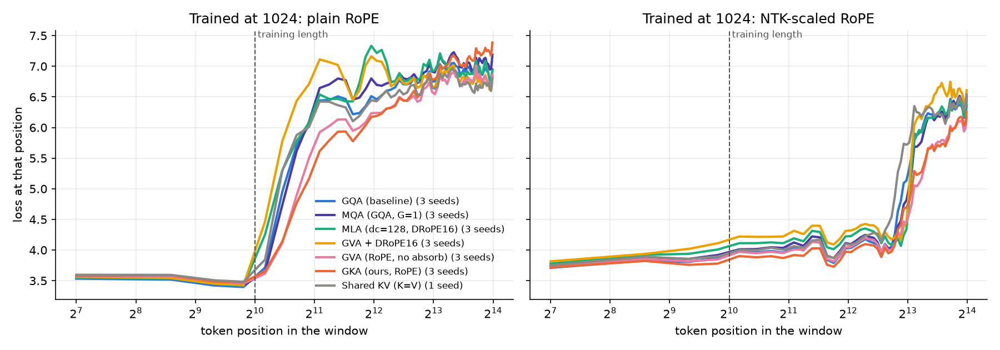

# GKA: Grouped Key Attention

Grouped Value Attention (GVA; Tripathi, Kumar & Khan) shrinks the KV cache by caching grouped **values** and rebuilding per-head keys from them. GKA is the mirror image: it caches grouped **keys** and rebuilds per-head values. This repo trains GKA from scratch against GQA, MQA, GVA (two versions), MLA and a Shared-KV floor under one identical recipe, then compares quality, long-context behaviour and inference speed.

**Question:** at half of GQA's KV cache, is GKA as good as the alternatives?

## Result in one paragraph

**No, not on quality.** At 48M parameters and 1B tokens, GKA is 0.035 val loss behind plain MQA at the same 50% cache size (3 seeds each, about 5 standard errors). It also trails GVA with ordinary RoPE by 0.013. Its strengths are elsewhere. It keeps ordinary RoPE and still absorbs its reconstruction at decode, which makes it the fastest model at batch 1 and in prefill and 2× faster than GVA (RoPE) at batch 32. Together with GVA (RoPE), it also degrades least beyond the training length. The GVA paper's headline does not reproduce at this scale: GVA+DRoPE ties MQA despite a larger cache, and MLA is the strongest of the compressed methods. A [follow-up](#follow-up-can-gka-be-made-more-expressive) tried three ways to make GKA's values more expressive while keeping it absorbable. Letting each head's values read both key groups closes the gap to GVA (RoPE), but not to MQA. Rotating the values with RoPE makes things worse.

## Method

| | cached per token | rebuilt | absorbed at decode into |
|---|---|---|---|
| GQA | $K_g$ (rotated), $V_g$ | – | – |
| GVA | $V_g$ | $K_h = V_g M_h$ | the query, $\tilde{q}_h = q_h M_h^\top$ (needs decoupled RoPE) |
| **GKA** | **$K_g$ (unrotated)** | **$V_h = K_g N_h$** | **the output projection, $N_h W_O^h$** |

In GVA, $M_h$ sits between the two RoPE rotations,

$$
q \, R_{j-t} \, M_h^\top v^\top ,
$$

so it can only be absorbed if position is moved to a separate decoupled slice (DRoPE). In GKA the reconstruction happens after the softmax:

$$
o_t = \sum_h \operatorname{softmax}_j \left( \underbrace{\frac{q_t R_t \left( k_j R_j \right)^\top}{\sqrt{d}}}_{\text{rotate cached } K \text{ on the fly}} \right) k_j \underbrace{N_h W_O^h}_{\text{one fixed matrix}}
$$

So GKA keeps ordinary RoPE, caches exactly 50% of GQA, and never materialises per-head values. The cost is expressivity: because $N_h W_O^h$ collapses into one matrix, GKA spans the same function class as Shared KV (values = unrotated keys) with a per-head output projection. GVA with ordinary RoPE does not collapse this way.

| model | name | cache scalars / token / layer |
|---|---|---|
| GQA (2 KV groups) | `gqa` | 256 (100%) |
| MQA (1 KV group) | `gqa_g1` | 128 (50%) |
| MLA, DeepSeek-V2 (latent 128 + RoPE key 16, absorbed) | `mla` | 144 (56%) |
| GVA + DRoPE16, the GVA paper's design (absorbed) | `gva_drope` | 144 (56%) |
| GVA, ordinary RoPE (cannot absorb) | `gva` | 128 (50%) |
| **GKA, ordinary RoPE (absorbed)** | `gka` | 128 (50%) |
| Shared KV, K = V (the GVA paper's floor) | `sharedkv` | 128 (50%) |

`tests/test_model.py` checks that every model's cached, absorbed decode path reproduces its full forward pass.

## Setup

* **Model:** 8 layers, $d_\text{model} = 512$, 8 query heads, 2 KV groups, $d_h = 64$, SwiGLU, RMSNorm, tied embeddings, GPT-2 BPE, about 48M params.
* **Training:** 1B FineWeb-Edu tokens (about Chinchilla for 48M), 1024 context, 131k-token batches, AdamW (0.9, 0.95), lr 1.5e-3 with cosine decay, wd 0.1, ZClip gradient clipping, bf16, one A100. Every run sees the same data in the same order; the seed changes only the initialisation.
* **Runs:** 3 seeds (1337, 1, 2) for every model except Shared KV (1 seed, a reference floor). 19 runs in the main comparison, plus 9 for the [follow-up](#follow-up-can-gka-be-made-more-expressive).
* **Metrics:** held-out val loss on 3.3M tokens (primary); the GVA paper's 5 zero-shot tasks plus PIQA and LAMBADA; loss at 1k–16k context with plain and NTK-scaled RoPE; decode and prefill speed.

## Results

All numbers are mean ± std over seeds. Full tables: [`results/results.md`](results/results.md), [`results/long_context.md`](results/long_context.md).

### Quality

| Model | Cache | Val loss ↓ | Δ vs GQA | LAMBADA acc | 5-task avg (paper) |
|---|---|---|---|---|---|
| GQA | 100% | **3.4810 ± 0.0025** | – | **16.5 ± 0.4** | 34.12 ± 0.29 |
| MLA | 56% | 3.4961 ± 0.0102 | +0.015 | 16.3 ± 0.9 | 33.87 ± 0.23 |
| MQA | 50% | 3.5068 ± 0.0092 | +0.026 | 15.4 ± 1.0 | 34.27 ± 0.51 |
| GVA + DRoPE16 | 56% | 3.5090 ± 0.0115 | +0.028 | 15.3 ± 0.1 | 34.02 ± 0.20 |
| GVA (RoPE) | 50% | 3.5288 ± 0.0045 | +0.048 | 15.2 ± 0.4 | 34.26 ± 0.47 |
| **GKA (RoPE)** | 50% | 3.5420 ± 0.0054 | +0.061 | 14.5 ± 0.6 | 33.90 ± 0.17 |
| Shared KV | 50% | 3.5585 (1 seed) | +0.078 | 13.9 | 33.97 |


* **GKA vs MQA, same cache:** GKA is 0.035 worse, about 5 standard errors. One key group plus one independent value group (MQA) beats two key groups with values derived from them (GKA).
* **GKA vs GVA (RoPE):** GKA is 0.013 worse, about 3 standard errors. Deriving values from keys is a little worse than deriving keys from values, consistent with GKA's collapsed function class. GKA closes only about a third of the Shared KV → MQA gap; GVA (RoPE) closes more than half.
* **MLA, MQA and GVA+DRoPE are statistically tied.** Their spreads (about 0.01) are as large as the gaps between them.
* **The 5-task average carries no signal at this scale:** every model is between 33.9 and 34.3, within seed noise and a few points above chance. LAMBADA is the only benchmark that still discriminates, and it ranks the models in the same order as val loss.

### Inference (A100, bf16, PyTorch eager, 64 decoded tokens)

| Model | Cache MB (B=32, T=4096) | decode tok/s B=1, T=4096 | decode tok/s B=32, T=4096 | prefill ms B=32, T=4096 |
|---|---|---|---|---|
| GQA | 512 | 97 | 3003 | 1113 |
| MQA | 256 | 96 | **3045** | 1106 |
| MLA | 288 | 80 | 2497 | 1312 |
| GVA + DRoPE16 | 288 | 84 | 2586 | 1280 |
| GVA (RoPE) | 256 | 95 | 1410 | 1555 |
| **GKA (RoPE)** | 256 | **105** | 2851 | **1064** |
| Shared KV | 256 | 104 | 2830 | **1063** |

* **GKA is the fastest at batch 1 and in prefill,** tied with Shared KV, which has the same decode path. At batch 32 it is within 5% of GQA. Rotating the cached keys again at every step costs little on an A100. (On an L4, with far less memory bandwidth, it cost about 40%.)
* **GKA is 2× faster than GVA (RoPE) at batch 32,** which must rebuild every head's keys at each step because M cannot be absorbed.
* **Decode at this size is mostly launch-bound,** so halving the cache shows up as memory, not speed (MQA vs GQA: +1%). The cache savings matter more for large models.

### Long context (trained at 1024)

| Model | @1024 | plain @2048 | NTK @4096 | NTK @16384 |
|---|---|---|---|---|
| GQA | **3.456 ± 0.004** | 4.295 ± 0.059 | 3.961 ± 0.043 | 5.137 ± 0.077 |
| MQA | 3.480 ± 0.008 | 4.268 ± 0.186 | 3.924 ± 0.157 | 5.130 ± 0.145 |
| MLA | 3.471 ± 0.010 | 4.414 ± 0.085 | 3.918 ± 0.064 | 5.152 ± 0.056 |
| GVA + DRoPE16 | 3.485 ± 0.011 | 4.685 ± 0.116 | 4.062 ± 0.110 | 5.326 ± 0.065 |
| GVA (RoPE) | 3.504 ± 0.004 | 4.000 ± 0.051 | **3.768 ± 0.034** | 4.868 ± 0.045 |
| **GKA (RoPE)** | 3.518 ± 0.006 | **3.957 ± 0.104** | 3.802 ± 0.055 | **4.864 ± 0.088** |
| Shared KV | 3.534 | 4.395 | 4.189 | 5.282 |



* **GKA and GVA (RoPE) degrade least beyond the training length,** with plain RoPE and with NTK scaling. At 16k with NTK they are about 0.27 better than GQA and MQA, well outside the seed spread. Shared KV does not share this, so it is not explained by having fewer independent parameters.
* **The DRoPE models extrapolate worst.** Their 16-dim positional slice breaks down first.
* Every model is far worse at 16k than at 1024. This is "breaks down less", not "works at long context".

## Follow-up: can GKA be made more expressive?

GKA's weakness is that $N_h W_O^h$ collapses into one matrix. Three variants try to fix this without giving up the 50% cache or the absorbed decode (3 seeds each):

| name | values seen by head $h$ | what it changes |
|---|---|---|
| `gka_xg` | $[k^{(1)}_j, k^{(2)}_j] \, N_h$ | values read **both** key groups (128 dims, not 64). Still collapses, but into a wider value. +0.26M params. |
| `gka_vrope` | $k_j R_{j-t} \, N_h$ | values are the **rotated** keys, rotated back by the query's position. The relative rotation sits between $k_j$ and $N_h$, so it no longer collapses. Implemented as: aggregate rotated keys, then apply $R_t^\top$, then $N_h W_O^h$. |
| `gka_xg_vrope` | $[k^{(1)}_j, k^{(2)}_j] R_{j-t} \, N_h$ | both |

`tests/test_model.py` checks each against this per-pair definition, as well as decode against forward.

| Model | Val loss ↓ | Δ vs GKA | plain @2048 | NTK @16384 | decode tok/s B=32 | prefill ms B=32 |
|---|---|---|---|---|---|---|
| GVA (RoPE), for reference | 3.5288 ± 0.0045 | −0.013 | 4.000 ± 0.051 | 4.868 ± 0.045 | 1410 | 1555 |
| GKA | 3.5420 ± 0.0054 | – | **3.957 ± 0.104** | **4.864 ± 0.088** | **2851** | **1064** |
| GKA + cross-group V | **3.5315 ± 0.0056** | **−0.011** | 4.128 ± 0.141 | 5.033 ± 0.123 | 2660 | 1109 |
| GKA + rotated V | 3.5706 ± 0.0051 | +0.029 | 4.215 ± 0.065 | 5.143 ± 0.040 | 2359 | 1361 |
| GKA + cross-group + rotated V | 3.5403 ± 0.0063 | −0.002 | 4.339 ± 0.108 | 5.209 ± 0.060 | 2121 | 1421 |

* **Cross-group values help.** They improve on GKA by 0.011, about 2.3 standard errors, and tie with GVA (RoPE). They keep absorption, decode 1.9× faster than GVA (RoPE) at batch 32 and cost only 7% vs GKA. They are still 0.025 behind MQA.
* **Rotated values hurt.** They are 0.029 worse than GKA (about 7 standard errors) and even worse than Shared KV. The likely reason is that a value rotated by $R_{j-t}$ depends on its distance from the query. In the high-frequency RoPE dimensions, the same content then points in a different direction at every distance, and averaging over many positions scrambles it. Breaking the collapse this way adds position-dependence, not useful capacity.
* **Combining them cancels out.** The cross-group gain and the rotation loss leave the combination level with plain GKA, at the highest decode cost of the four.
* **All three lose GKA's long-context edge.** At NTK @16384 they are 0.17–0.35 behind GKA, which puts them back with GQA and MQA. Plain, unrotated values derived from the keys seem to be what made GKA extrapolate well.

## Conclusions

1. **At 50% cache, use MQA, not GKA,** if quality at the training length is what matters. GKA's $V = KN$ constraint costs about 0.035 val loss here.
2. **GKA does deliver what it was designed for:** an absorbable 50%-cache attention with ordinary RoPE. It is the fastest model at batch 1 and in prefill, 2× faster than GVA (RoPE), and among the best at extrapolating past the training length.
3. **The GVA paper's result does not reproduce at 48M / 1B tokens.** GVA+DRoPE ties MQA despite a 12% larger cache, and MLA matches or beats it at the same cache size.
4. **GKA with cross-group values reaches GVA (RoPE) quality at about twice its batch-32 decode speed,** but gives up GKA's long-context advantage. Rotating the values is a dead end.

### Caveats

* These are small models, 48M params and 1B tokens. The GVA paper's claims are at 350M params and 30B tokens, and rankings may change with scale.
* Shared KV is one seed. Gaps under about 0.02 involving MLA, MQA and GVA+DRoPE are within noise.
* The speed numbers come from straightforward PyTorch code, not fused kernels. MLA and GVA+DRoPE also train about 25% slower here, because their 80-wide q/k vs 64-wide v rules out the fastest attention kernel. That is an implementation detail, not a property of the methods. The same applies to `gka_xg_vrope` (128-wide values, 30% slower to train).
* `mla_s1` and `gva_drope_s2` resumed from a checkpoint after a Colab disconnect. Their results are unaffected, but their `log.jsonl` starts at the resume step.

## Repository layout

```
gka/
  model.py                  every attention variant, absorbed cached decode paths, NTK RoPE scaling
  zclip.py                  ZClip adaptive gradient clipping
  runs.py                   the run list, run naming (gka_s1, gqa_g1_s2, ...) and checkpoint loading
  paths.py, style.py        file locations (overridable by env vars) and plot labels/colours
scripts/
  colab.sh                  the whole experiment on a Colab A100, in resumable stages
  prepare_data.py           FineWeb-Edu -> data/{train,val}.bin
  train.py                  train one run (resumable) -> runs/<name>/
  evaluate.py               zero-shot benchmarks -> runs/<name>/benchmarks.json
  eval_long_context.py      loss at 1k-16k, plain and NTK RoPE -> runs/<name>/long_context.json
  bench_inference.py        cache size, prefill and decode speed -> results/inference.json
  bench_train_throughput.py training tok/s and projected cost per run
  analyze.py, analyze_long_context.py   -> results/*.md, results/figures/
tests/test_model.py         decode == forward for every model, cache sizes, ZClip, run names
runs/<name>/                summary.json, log.jsonl, benchmarks.json, long_context.json
results/                    results.md, long_context.md, inference.json, figures/
```

Not in git: `data/`, `logs/` and the `runs/*/model.pt` checkpoints.

## Reproduce

Needs [uv](https://docs.astral.sh/uv/) and an NVIDIA GPU (the lockfile pins PyTorch for CUDA 12.8). One run takes about 45 min on an A100 (about 58 min for MLA and GVA+DRoPE, 64 min for `gka_xg_vrope`). All 28 runs plus evals cost about 170 Colab compute units (120 for the main 19).

On Colab (A100), after mounting Google Drive:

```bash
git clone -b from-scratch https://github.com/ojasinha/gka.git /content/gka
bash /content/gka/scripts/colab.sh setup     # dependencies + tokenized data (cached on Drive)
bash /content/gka/scripts/colab.sh train     # all 28 runs; re-run after a disconnect to resume
bash /content/gka/scripts/colab.sh eval      # zero-shot + long-context
bash /content/gka/scripts/colab.sh bench     # inference
bash /content/gka/scripts/colab.sh analyze   # tables and figures
```

Locally:

```bash
uv sync
uv run pytest
uv run python scripts/prepare_data.py
uv run python scripts/train.py --run gka_s1 --compile   # --compile needs Linux (Triton)
uv run python scripts/analyze.py
```
