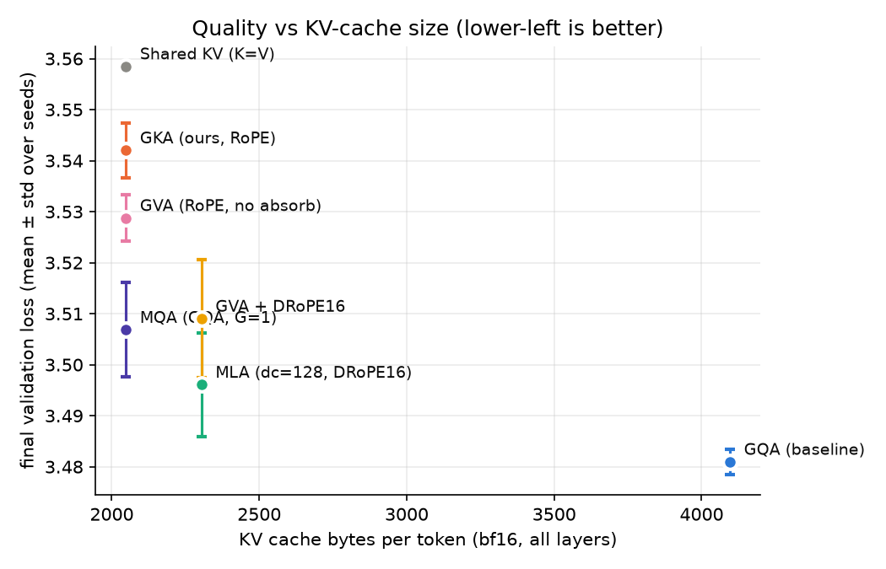

# GKA: Grouped Key Attention

**Grouped Key Attention (GKA)** is the mirror image of Grouped Value Attention (GVA; Tripathi, Kumar & Khan): instead of caching grouped **values** and reconstructing per-head keys, GKA caches grouped **keys** and reconstructs per-head values.

This repository trains GKA from scratch under an identical 48M-parameter, 1B-token recipe against GQA, MQA, GVA (two variants), MLA, a Shared-KV baseline, and three GKA expressivity extensions — 28 runs in total — comparing language-modeling quality, zero-shot benchmarks, long-context extrapolation, and inference speed/memory.

**Core question:** At 50% of GQA's KV cache, can GKA match MQA, GVA, or MLA?

---

## Key Findings

* **On quality, no — MQA is better at the same 50% cache.** GKA trails plain MQA by **0.035 val loss** (`3.5420` vs `3.5068`, ~5.7 SE across 3 seeds) and trails GVA with ordinary RoPE by **0.013** (`3.5288`, ~3.3 SE). One independent key group plus one value group (MQA) beats two key groups whose values are linearly derived from them.
* **Why:** Because GKA's value reconstruction $N_h$ merges into the output projection $W_O^h$, plain GKA spans the **same function class as Shared KV** ($K = V$). Its edge over Shared KV (`3.5420` vs `3.5585`, 1 seed) comes from the over-parameterized factorization $N_h W_O^h$ during optimization, not higher representational capacity.
* **On inference speed, GKA delivers what it was built for.** It keeps standard RoPE while still absorbing its reconstruction into $W_O$ at decode. In eager PyTorch on an A100, it is the **fastest model in prefill and at batch 1–16 decode**, stays within 5% of GQA/MQA at batch 32, and runs **2× faster than GVA (RoPE)** at batch 32 with half the peak decode memory.
* **On long-context extrapolation, GKA and GVA (RoPE) degrade least.** Beyond the 1024-token training window, both lose ~0.27–0.34 less nats than GQA/MQA (with plain RoPE at 2k–4k and with NTK scaling up to 16k), while decoupled-RoPE models (`GVA + DRoPE16`, `MLA`) degrade fastest under plain RoPE.
* **The GVA paper's headline does not reproduce at this scale (48M / 1B tokens).** `GVA + DRoPE16` ties MQA (`3.5090` vs `3.5068`) despite using 12.5% more cache, and MLA (`3.4961`) is the strongest compressed method overall (though MLA, MQA, and GVA+DRoPE are within ~1.5 SE of each other).
* **Follow-up variants:** Letting each head read **both** key groups (`gka_xg`) genuinely expands capacity, closing the gap to GVA (RoPE) (`3.5315` vs `3.5288`) at 1.9× its batch-32 decode speed — though still 0.025 behind MQA. Applying relative RoPE to values (`gka_vrope`) makes quality significantly worse (`3.5706`, below Shared KV). All three follow-up variants lose GKA's long-context edge.

---

## How GKA Works

| Variant | Cached per token | Reconstructed | Absorbed at decode into | Positional encoding |
|---|---|---|---|---|
| **GQA** | $K_g$ (rotated), $V_g$ | — | — | Standard RoPE |
| **GVA (RoPE)** | $V_g$ | $K_h = V_g M_h$ | *Cannot absorb* | Standard RoPE |
| **GVA + DRoPE** | $V_g$, shared $K_r$ | $K_h^c = V_g M_h$ | Query: $\tilde{q}_h^c = q_h^c M_h^\top$ | Decoupled RoPE (+$d_r$ cache) |
| **GKA (ours)** | **$K_g$ (unrotated)** | **$V_h = K_g N_h$** | **Output projection: $\tilde{W}_O^h = N_h W_O^h$** | **Standard RoPE** |

### Why GKA absorbs with ordinary RoPE (and GVA cannot)

In **GVA with ordinary RoPE**, the per-head reconstruction matrix $M_h$ sits between the relative rotation and the cached value:

$$
\left(q_{h,t} R_t\right)\left(v_{g,j} M_h R_j\right)^\top = q_{h,t} \, R_{t-j} \, M_h^\top \, v_{g,j}^\top
$$

Because $M_h^\top$ does not commute with $R_{t-j}$, it cannot be folded into $q_{h,t}$. Serving GVA therefore forces a choice: either materialize and rotate all $H$ heads' keys at every decode step (`gva`), or move RoPE into a separate decoupled slice (`gva_drope`), adding $d_r$ scalars per token to the cache.

In **GKA**, reconstruction happens *after* the attention weights:

$$
o_t = \sum_{h=1}^{H} \sum_{j \le t} \operatorname{softmax}_j \!\left( \frac{\left(q_{h,t} R_t\right)\left(k_{g,j} R_j\right)^\top}{\sqrt{d_h}} \right) k_{g,j} \underbrace{\left(N_h W_O^h\right)}_{\tilde{W}_O^h \text{ (fixed at inference)}}
$$

Because the cache stores **unrotated** keys $k_{g,j}$, GKA rotates $k_{g,j}$ on the fly to compute scores (a pure elementwise op), aggregates the unrotated $k_{g,j}$, and multiplies once by the pre-merged matrix $\tilde{W}_O^h = N_h W_O^h$. It never materializes per-head values and needs no decoupled RoPE slice.

### The expressivity catch

That absorption comes with a structural cost:
* **Plain GKA collapses to Shared KV's function class.** In Shared KV ($V = K$), `o_proj` already gives each head its own unconstrained $d_h \times d_\text{model}$ matrix $W_O^h$. Replacing $W_O^h$ with $N_h W_O^h$ (where $N_h \in \mathbb{R}^{d_h \times d_h}$) spans the exact same set of functions — any gain over Shared KV comes purely from optimization dynamics of the factorized linear map.
* **GVA (RoPE) does *not* collapse.** Because $M_h^\top$ does not commute with $R_{t-j}$, each head can align different linear combinations of $V_g$ with the RoPE frequency bands.
* **GVA + DRoPE** collapses $W_{Q,c}^h M_h^\top$ on the content branch, *but* gains a dedicated 16-dim positional key projected directly from $x$, freeing the 128 cached value scalars from carrying RoPE features.

`tests/test_model.py` verifies that every variant's cached, absorbed `step()` path matches its full `forward()` pass.

---

## Experimental Setup

* **Architecture:** 8-layer decoder-only Transformer, $d_\text{model} = 512$, 8 query heads, 2 KV groups (except MQA with 1 group), $d_h = 64$, SwiGLU MLP, RMSNorm, tied GPT-2 BPE embeddings (`vocab_size = 50,304`), ~48M total parameters (~22–24M non-embedding, ~5M in attention).
* **Training:** 1B FineWeb-Edu tokens (7,629 steps × 131,072 tokens/step, roughly Chinchilla-optimal for 48M params), context length 1024, AdamW ($\beta_1=0.9, \beta_2=0.95$, lr `1.5e-3` with 200-step warmup and cosine decay to `1.5e-4`, weight decay `0.1`), ZClip adaptive gradient clipping, `bf16` autocast with `torch.compile`, NVIDIA A100-40GB. Every run sees the exact same token windows in the same order; `--seed` changes initialization only.
* **Runs:** 3 seeds (`1337`, `1`, `2`) for all 6 core models and all 3 GKA follow-up variants, plus 1 seed for Shared KV as a reference floor — **28 runs total** (19 main + 9 follow-up).
* **Evaluation:**
  * *Primary:* Held-out validation loss on **3.28M** FineWeb-Edu tokens (400 batches × 8 × 1024).
  * *Zero-shot:* The GVA paper's 5-task average (HellaSwag, WinoGrande, OpenBookQA, ARC-Easy, ARC-Challenge), plus PIQA and LAMBADA.
  * *Long context:* Loss at 1k–16k tokens on **262k** held-out tokens (the prefix of `val.bin`), with plain RoPE and with inference-time NTK scaling ($\text{factor} = \text{context} / 1024$).
  * *Inference:* Cache footprint, prefill latency, decode throughput (64 tokens), and peak decode memory in `bf16` eager PyTorch on an A100-40GB.

### Models Compared

| Model | Run key | Cache scalars / tok / layer | Cache vs GQA | Params |
|---|---|---|---|---|
| GQA (2 KV groups, baseline) | `gqa` | 256 | 100.0% | 48.31M |
| MQA (1 KV group) | `gqa_g1` | 128 | 50.0% | 47.78M |
| MLA (DeepSeek-V2, $d_c=128$, DRoPE16, absorbed) | `mla` | 144 | 56.2% | 49.42M |
| GVA + DRoPE16 (GVA paper's serving design, absorbed) | `gva_drope` | 144 | 56.2% | 48.64M |
| GVA (ordinary RoPE, cannot absorb) | `gva` | 128 | 50.0% | 48.05M |
| **GKA (ordinary RoPE, absorbed)** | `gka` | 128 | 50.0% | 48.05M |
| Shared KV ($K=V$, 1-seed floor) | `sharedkv` | 128 | 50.0% | 47.78M |
| *Follow-up:* GKA + cross-group V | `gka_xg` | 128 | 50.0% | 48.31M |
| *Follow-up:* GKA + rotated V | `gka_vrope` | 128 | 50.0% | 48.05M |
| *Follow-up:* GKA + cross-group + rotated V | `gka_xg_vrope` | 128 | 50.0% | 48.31M |

---

## Results

All multi-seed numbers are **mean ± sample std** across 3 seeds. Full tables live in [`results/results.md`](results/results.md) and [`results/long_context.md`](results/long_context.md).

### 1. Quality at the Training Length (1024 tokens)

| Model | Cache | Val loss ↓ | Δ vs GQA | Val PPL ↓ | LAMBADA acc ↑ | LAMBADA PPL ↓ | 5-task avg (paper) |
|---|---|---|---|---|---|---|---|
| GQA (baseline) | 100.0% | **3.4810 ± 0.0025** | — | **32.5 ± 0.1** | **16.5 ± 0.4** | **588 ± 52** | 34.12 ± 0.29 |
| MLA ($d_c$=128, DRoPE16) | 56.2% | 3.4961 ± 0.0102 | +0.0151 | 33.0 ± 0.3 | 16.3 ± 0.9 | 668 ± 76 | 33.87 ± 0.23 |
| MQA (GQA, $G$=1) | 50.0% | 3.5068 ± 0.0092 | +0.0259 | 33.3 ± 0.3 | 15.4 ± 1.0 | 692 ± 84 | 34.27 ± 0.51 |
| GVA + DRoPE16 | 56.2% | 3.5090 ± 0.0115 | +0.0281 | 33.4 ± 0.4 | 15.3 ± 0.1 | 744 ± 36 | 34.02 ± 0.20 |
| GVA (RoPE, no absorb) | 50.0% | 3.5288 ± 0.0045 | +0.0478 | 34.1 ± 0.2 | 15.2 ± 0.4 | 733 ± 37 | 34.26 ± 0.47 |
| **GKA (ours, RoPE)** | 50.0% | 3.5420 ± 0.0054 | +0.0610 | 34.5 ± 0.2 | 14.5 ± 0.6 | 810 ± 81 | 33.90 ± 0.17 |
| Shared KV ($K=V$, 1 seed) | 50.0% | 3.5585 | +0.0775 | 35.1 | 13.9 | 1036 | 33.97 |



* **GKA vs. MQA (same 50% cache):** GKA is **0.0352 worse** (~5.7 SE; every single seed of MQA beats every seed of GKA). Separating keys and values into two dedicated 64-dim groups (MQA) beats spending all 128 cached scalars on two key groups and reconstructing values from them.
* **GKA vs. GVA (RoPE) (same 50% cache, same RoPE):** GKA is **0.0132 worse** (~3.3 SE; consistent across all 3 seeds: `+0.0124`, `+0.0131`, `+0.0142`). Reconstructing values from keys hurts slightly more than reconstructing keys from values, matching the theoretical asymmetry (GKA collapses into $W_O$; GVA with ordinary RoPE does not).
* **GVA + DRoPE16 vs. GVA (RoPE):** Adding the 16-dim decoupled RoPE slice improves GVA by **0.0197** (~2.8 SE) — at the cost of 12.5% more cache (56.2% vs 50.0%).
* **MLA, MQA, and GVA + DRoPE16 are statistically close:** MLA has the best mean (`3.4961`), ahead of MQA (`3.5068`) and GVA+DRoPE16 (`3.5090`), but all three have ~0.010 seed std, so the pairwise gaps between them are within ~1.5 SE. All three clearly lag full GQA (`3.4810`, 2.5–4.7 SE).
* **Zero-shot tasks at 48M scale:** The GVA paper's 5-task average carries no usable signal here — every model sits between `33.86%` and `34.27%`, just above chance and buried in seed noise. **LAMBADA** is the only downstream benchmark that separates models, and it mirrors the validation-loss ranking closely.

---

### 2. Inference Speed & Memory

Measured in `bf16` eager PyTorch on an **NVIDIA A100-SXM4-40GB** (64 decoded tokens, no custom fused kernels):

| Model | Cache MB (B=32, T=4096) | Peak decode MB (B=32, T=4096) | Decode tok/s (B=1, T=4096) | Decode tok/s (B=16, T=4096) | Decode tok/s (B=32, T=4096) | Prefill ms (B=32, T=4096) |
|---|---|---|---|---|---|---|
| GQA | 512 | 526 | 97 | 1496 | 3003 | 1113 |
| MQA | 256 | **270** | 96 | 1493 | **3045** | 1106 |
| MLA | 288 | 311 | 80 | 1240 | 2497 | 1312 |
| GVA + DRoPE16 | 288 | 302 | 84 | 1272 | 2586 | 1280 |
| GVA (RoPE, no absorb) | 256 | 644 | 95 | 1168 | 1410 | 1555 |
| **GKA (ours, RoPE)** | 256 | 328 | **105** | **1596** | 2851 | **1064** |
| Shared KV | 256 | 324 | 104 | 1590 | 2830 | **1063** |

* **GKA is fastest at B=1, B=16, and prefill** (tied with Shared KV, which executes the same decode path), and within 5% of GQA/MQA at B=32.
* **Absorption matters hugely at batch 32:** GKA is **2.0× faster** than GVA (RoPE) (`2851` vs `1410 tok/s`) and uses **half the peak decode memory** (`328 MB` vs `644 MB`). Without absorption, GVA (RoPE) materializes all 8 heads' reconstructed keys every step, using *more* peak memory than full GQA (`526 MB`).
* **On-the-fly key rotation is cheap on A100, costlier on lower-bandwidth GPUs:** Re-rotating cached keys in eager PyTorch adds ~72 MB of temporary buffers at B=32, T=4096 (`328` vs MQA's `270 MB`) and costs ~5% throughput on an A100. On an earlier L4 benchmark (much lower memory bandwidth), the same eager re-rotation cost ~40% at B=32 (`1800` vs GQA `2982 tok/s`). A fused attention kernel applying RoPE in registers would eliminate both the extra memory and bandwidth overhead.
* **Small-model decode is launch-bound:** At 48M params, halving the KV cache shows up in memory footprint rather than throughput (MQA vs GQA is +1% at B=32). At larger scales where decode is strictly memory-bandwidth-bound, the 2× cache reduction translates directly into speed.

---

### 3. Long-Context Extrapolation (Trained at 1024)

Evaluated on 262k held-out tokens (*the smaller prefix subset explains why `@1024` here is ~0.025 lower than the 3.28M-token validation loss above*):

| Model | plain @1024 | plain @2048 | plain @4096 | NTK @4096 | NTK @8192 | NTK @16384 |
|---|---|---|---|---|---|---|
| GQA | **3.456 ± 0.004** | 4.295 ± 0.059 | 5.367 ± 0.064 | 3.961 ± 0.043 | 4.557 ± 0.070 | 5.137 ± 0.077 |
| MQA | 3.480 ± 0.008 | 4.268 ± 0.186 | 5.478 ± 0.054 | 3.924 ± 0.157 | 4.523 ± 0.191 | 5.130 ± 0.145 |
| MLA | 3.471 ± 0.010 | 4.414 ± 0.085 | 5.568 ± 0.033 | 3.918 ± 0.064 | 4.520 ± 0.053 | 5.152 ± 0.056 |
| GVA + DRoPE16 | 3.485 ± 0.011 | 4.685 ± 0.116 | 5.797 ± 0.070 | 4.062 ± 0.110 | 4.698 ± 0.085 | 5.326 ± 0.065 |
| GVA (RoPE) | 3.504 ± 0.004 | 4.000 ± 0.051 | 5.054 ± 0.049 | **3.768 ± 0.034** | **4.277 ± 0.048** | 4.868 ± 0.045 |
| **GKA (ours, RoPE)** | 3.518 ± 0.006 | **3.957 ± 0.104** | **4.942 ± 0.076** | 3.802 ± 0.055 | 4.288 ± 0.108 | **4.864 ± 0.088** |
| Shared KV (1 seed) | 3.534 | 4.395 | 5.364 | 4.189 | 4.748 | 5.282 |


* **Plain GKA and GVA (RoPE) degrade the least beyond 1024.** At plain @2048 they beat GQA by ~0.30–0.34 nats (~5–6 SE), and at NTK @16384 they still lead GQA and MQA by **~0.27 nats** (`4.86` vs `5.13`, ~4–5 SE).
* **Decoupled RoPE extrapolates worst.** `GVA + DRoPE16` degrades fastest under both plain RoPE (`4.685` at 2k, +0.39 worse than GQA) and NTK scaling (`5.326` at 16k). `MLA` also degrades faster than GQA with plain RoPE (`4.414` at 2k), though NTK brings it back in line with GQA/MQA. Packing all positional signal into a 16-dim slice leaves fewer frequency bands to extrapolate smoothly.
* **Not simply a parameter-count effect:** Shared KV (`5.282` at NTK @16k) does *not* share GKA's extrapolation advantage, and all three GKA follow-up variants below lose it as well.
* **Caveat on absolute quality:** Every model breaks down sharply past ~6k–8k tokens even with NTK scaling (rising from ~3.5 to ~4.9–5.3 by 16k). This is "degrades less severely", not usable zero-shot 16k context.

---

## Follow-up: Can GKA Be Made More Expressive?

To test whether GKA can escape its $N_h W_O^h$ collapse **without** giving up its 50% cache or absorbed decode, we trained 3 variants (3 seeds each, 9 additional runs):

| Variant | Values for head $h$ | Idea |
|---|---|---|
| **`gka_xg`** (cross-group V) | $[k^{(1)}_j, k^{(2)}_j] \, N_h$ | Each head's value reads **both** key groups (128 dims instead of 64). Still absorbs into $W_O$, but lets group 1 heads borrow group 2's cached keys as a separate value subspace (and vice versa). +0.26M params. |
| **`gka_vrope`** (rotated V) | $\left(k^{(g)}_j R_{j-t}\right) N_h$ | Values use the rotated keys, rotated back by $R_t^\top$ after attention aggregation so $R_{j-t}$ sits between $k_j$ and $N_h$ — breaking the collapse while keeping $N_h$ absorbed into $W_O$. |
| **`gka_xg_vrope`** (both) | $[k^{(1)}_j, k^{(2)}_j] R_{j-t} \, N_h$ | Combines cross-group values and relative value rotation. |

| Model | Val loss ↓ | Δ vs GKA | LAMBADA acc ↑ | plain @2048 | NTK @16384 | Decode tok/s (B=32) | Prefill ms (B=32) |
|---|---|---|---|---|---|---|---|
| MQA *(reference, 50% cache)* | 3.5068 ± 0.0092 | −0.0352 | 15.4 ± 1.0 | 4.268 ± 0.186 | 5.130 ± 0.145 | **3045** | 1106 |
| GVA (RoPE) *(reference, 50% cache)* | 3.5288 ± 0.0045 | −0.0132 | 15.2 ± 0.4 | 4.000 ± 0.051 | 4.868 ± 0.045 | 1410 | 1555 |
| GKA | 3.5420 ± 0.0054 | — | 14.5 ± 0.6 | **3.957 ± 0.104** | **4.864 ± 0.088** | 2851 | **1064** |
| **GKA + cross-group V** (`gka_xg`) | **3.5315 ± 0.0056** | **−0.0105** | **15.7 ± 0.5** | 4.128 ± 0.141 | 5.033 ± 0.123 | 2660 | 1109 |
| GKA + rotated V (`gka_vrope`) | 3.5706 ± 0.0051 | +0.0285 | 13.4 ± 0.3 | 4.215 ± 0.065 | 5.143 ± 0.040 | 2359 | 1361 |
| GKA + both (`gka_xg_vrope`) | 3.5403 ± 0.0063 | −0.0017 | 14.6 ± 0.3 | 4.339 ± 0.108 | 5.209 ± 0.060 | 2121 | 1421 |

* **Cross-group values work as intended.** `gka_xg` improves on GKA by **0.0105** (~2.3 SE) and ties GVA (RoPE) (`3.5315` vs `3.5288`, 0.7 SE), while keeping absorption and decoding **1.9× faster** than GVA (RoPE) at batch 32 (only 7% slower than plain GKA). However, it still trails MQA by **0.0247** (~4.0 SE): both key slots must still serve as routing keys for half the heads, whereas MQA dedicates one full slot purely to keys and one purely to values.
* **Rotated values are a dead end.** `gka_vrope` is **0.0285 worse** than plain GKA (~6.7 SE) and worse than Shared KV (`3.5585`), dropping LAMBADA accuracy to `13.4%`. Multiplying values by $R_{j-t}$ makes a token's value vector spin with distance $j - t$; in the high-frequency RoPE dimensions, identical content points in different directions at every offset and destructively cancels when averaged across positions.
* **Combining both cancels out.** The cross-group gain and the value-rotation penalty offset each other (`3.5403` ≈ plain GKA `3.5420`), while paying the highest decode and training overhead.
* **All three lose GKA's long-context advantage.** At NTK @16384 they degrade to `5.03–5.21`, back in line with GQA and MQA.

---

## Conclusions & Limitations

1. **Use MQA (or MLA), not GKA, if in-distribution quality is the priority.** At 50% KV cache and 48M / 1B scale, MQA beats GKA by 0.035 val loss and `gka_xg` by 0.025, with simpler implementation and lower peak decode memory.
2. **GKA's real strengths are architectural simplicity and decode speed.** It is the cleanest way to get an absorbable, 50%-cache reconstructed-KV attention without decoupled RoPE — achieving the fastest prefill and B=1/B=16 decode, 2× GVA (RoPE)'s B=32 throughput, and strong extrapolation robustness.
3. **`gka_xg` dominates GVA (RoPE).** It matches GVA (RoPE) on quality (`3.5315` vs `3.5288`) while staying absorbable, 1.9× faster at B=32 decode, and using half the peak decode memory.
4. **Scale caveat:** All runs are at 48M parameters (only ~22M non-embedding, ~5M in attention) and 1B tokens, whereas the GVA paper reports near-GQA parity at 350M parameters and 30B tokens. Rankings — especially between MLA, GVA+DRoPE, MQA, and cross-group GKA — could shift at larger scale.
5. **Implementation & logging caveats:**
   * Inference numbers are eager PyTorch without custom fused kernels. During training (`torch.compile`), MLA and GVA+DRoPE run ~28% slower (~58 min vs ~45 min) because their 80-dim $Q/K$ vs 64-dim $V$ misses the fastest FlashAttention path; `gka_xg_vrope` runs ~47% slower (~66 min) due to 128-dim values. These are kernel/implementation effects, not fundamental FLOP costs.
   * Shared KV is a single-seed reference floor (`seed=1337`).
   * `mla_s1` and `gva_drope_s2` resumed cleanly from checkpoints after Colab disconnects (at steps 5500 and 6000 respectively); their final metrics are unaffected, though their `log.jsonl` files begin at the resume step.

---

## Repository Layout

```text
gka/
  model.py                     All 10 attention variants, absorbed cached decode paths, NTK RoPE scaling
  zclip.py                     ZClip adaptive gradient clipping
  runs.py                      Run naming (gka_s1, gqa_g1_s2, ...), experiment lists, checkpoint loading
  paths.py, style.py           Directory paths (env-var overridable) and plot styles
scripts/
  colab.sh                     End-to-end resumable pipeline for Colab A100
  prepare_data.py              Tokenize FineWeb-Edu -> data/{train,val}.bin
  train.py                     Resumable training script -> runs/<name>/
  evaluate.py                  Zero-shot benchmarks (5 paper tasks + PIQA + LAMBADA)
  eval_long_context.py         1k-16k plain and NTK-scaled RoPE evaluation
  bench_inference.py           KV cache footprint, prefill/decode speed, peak memory -> results/inference.json
  bench_train_throughput.py    Training throughput and Colab CU projections
  analyze.py                   Aggregates runs/ and inference.json -> results/results.md + figures
  analyze_long_context.py      Aggregates long-context evals -> results/long_context.md + figure
tests/
  test_model.py                Verifies absorbed decode == forward, cache sizes, init scale, ZClip, run names
runs/<name>/                   summary.json, log.jsonl, benchmarks.json, long_context.json
results/                       results.md, long_context.md, inference.json, figures/
```

Excluded from git: `data/`, `logs/`, and `runs/*/model.pt` weights.

---

## Reproducing the Results

Requires [uv](https://docs.astral.sh/uv/) and an NVIDIA GPU (`uv.lock` pins PyTorch for CUDA 12.8). On a Colab A100-40GB, a standard 1B-token run takes ~45 min (~58 min for MLA and GVA+DRoPE, ~66 min for `gka_xg_vrope`). Training all 28 runs takes ~23.5 GPU-hours (~158 Colab compute units for training; ~170 CU including evals and benchmarks).

### On Google Colab (A100)

Mount Google Drive first, then run each stage (all stages skip completed runs and resume cleanly after disconnects):

```bash
git clone -b from-scratch https://github.com/ojasinha/gka.git /content/gka
bash /content/gka/scripts/colab.sh setup     # install deps + tokenize/cache data on Drive
bash /content/gka/scripts/colab.sh train     # train all 28 runs (re-run to resume)
bash /content/gka/scripts/colab.sh eval      # zero-shot + long-context evals
bash /content/gka/scripts/colab.sh bench     # inference benchmark
bash /content/gka/scripts/colab.sh analyze   # regenerate tables and figures
```

### Locally

```bash
uv sync
uv run pytest
uv run python scripts/prepare_data.py
uv run python scripts/train.py --run gka_s1 --compile   # --compile requires Linux (Triton)
uv run python scripts/analyze.py
uv run python scripts/analyze_long_context.py
```
