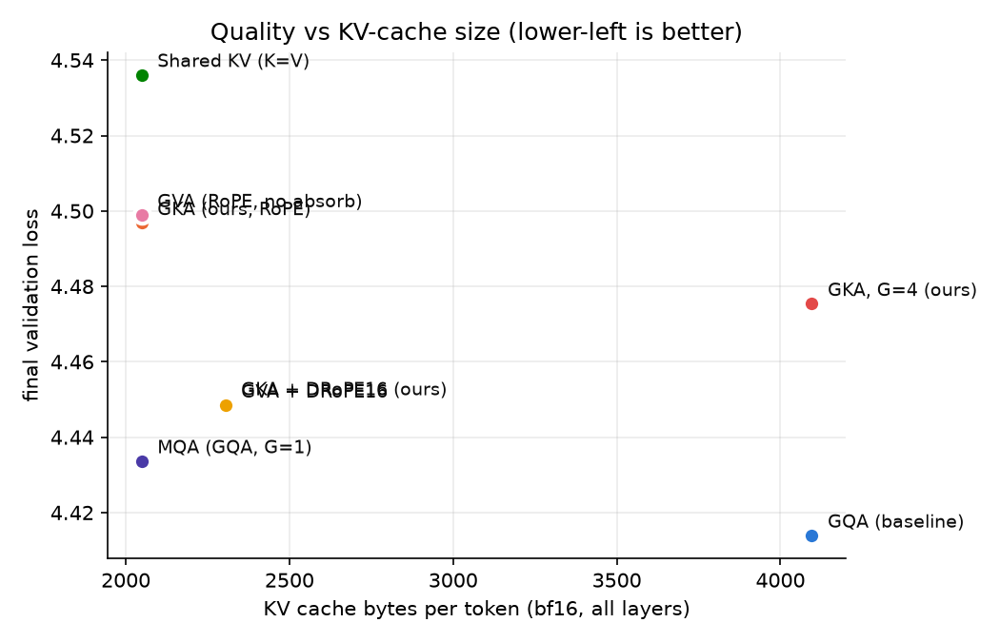
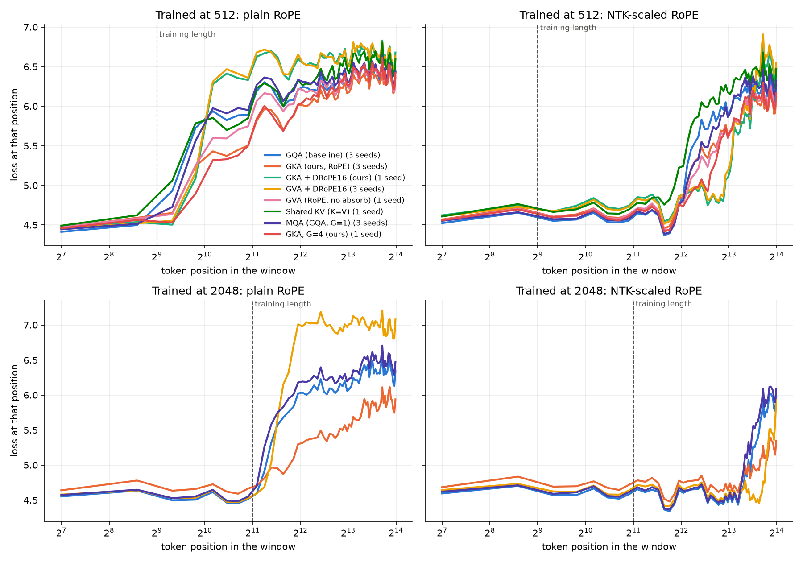

# GKA: Grouped Key Attention

GKA mirrors Grouped Value Attention (GVA; Tripathi, Kumar & Khan, FrontiersMind). GVA caches grouped **values** and rebuilds per-head keys. GKA caches grouped **keys** and rebuilds per-head values. This repo implements both, along with GQA, MQA and Shared-KV baselines. It trains each one from scratch (48M params, 3 seeds for the main models) and compares quality, long-context behaviour and inference cost.

**Question:** can GKA match GQA quality with a smaller KV cache, or beat GVA?

## TL;DR

| Finding | Evidence (3 seeds unless noted) |
|---|---|
| GKA's mechanism works: N folds into W_O, so GKA decodes with **ordinary RoPE at exactly 50% of GQA's cache**. GVA cannot; it needs a decoupled RoPE slice (56% cache). | decode == forward tests, all variants |
| **At the trained length, GKA does not reach GQA quality.** The ranking is GQA < MQA < GVA+DRoPE < GKA, and it holds in every seed. | val loss 4.414 / 4.434 / 4.448 / 4.497 |
| **GKA vs GVA: caching keys vs values doesn't change quality.** Under the same RoPE setup they tie, but with ordinary RoPE only GKA can absorb, which gives it 5× faster decode and half the memory. | DRoPE: 4.449 vs 4.448; RoPE: 4.497 vs 4.499 |
| **GKA extrapolates best past its training length without any tricks.** This holds at both training lengths, in every seed. | trained 2048 → 16k: GKA 5.48 vs GQA 5.93 |
| **With NTK RoPE scaling, GVA+DRoPE has the best long-context quality, beating GQA** with 44% less cache. | trained 2048 → 16k: 4.73 vs 4.93 |
| The DRoPE variants collapse past the training length **without** NTK scaling. | trained 2048 → 16k plain: 6.54 |

**In practice:** use GVA+DRoPE when you can apply NTK scaling at inference; it gives near-GQA quality in-distribution and better than GQA at long contexts. GKA is the choice when you need graceful length extrapolation with plain RoPE. Neither beats GQA at the trained length at this scale.

## Method

| | cached content | reconstructed | absorbed at decode into |
|---|---|---|---|
| GQA | K_g (rotated), V_g | — | — |
| GVA | V_g | K_h = V_g M_h | the query: q̃_h = q_h M_hᵀ |
| **GKA** | **K_g (unrotated)** | **V_h = K_g N_h** | **the output projection: W_O' = blockdiag(N_h) W_O** |

**RoPE does not break GKA's absorption.** In GVA, M_h sits between the two RoPE rotations, `q R_{j−t} M_hᵀ v_jᵀ`, so it cannot be folded into the query, and GVA needs a decoupled RoPE slice. In GKA the reconstruction happens after the softmax:

```
o_t = Σ_h softmax_j( q_t R_t (k_{j,g} R_j)ᵀ / √d ) · k_{j,g} N_h W_O^h
                    └─ score: rotate cached K on the fly ─┘   └ absorbed ┘
```

The cache stores the unrotated key, rotated elementwise for scoring. `N_h W_O^h` is a fixed matrix. So GKA keeps ordinary RoPE and caches exactly 50% of GQA.

**Expressivity.** Because `N_h W_O^h` collapses into one matrix, GKA spans the same function class as Shared KV (values = unrotated keys) with a per-head output projection. With decoupled RoPE, GVA's `W_Q^h M_hᵀ` collapses the same way. So GKA, GKA+DRoPE and GVA+DRoPE add no capacity over Shared KV, and any differences come from optimisation. The exception is GVA with ordinary RoPE. That is why `sharedkv` is included as a control, and why GKA+DRoPE and GVA+DRoPE end up tied.

### Variants (`gka/model.py`)

| name | description | cache scalars / token / layer (G=2, d_h=64, d_r=16) |
|---|---|---|
| `gqa` | grouped-query baseline | 256 |
| `gqa_g1` | MQA (GQA with one KV group); equal-cache control for GKA | 128 (−50%) |
| `gka` | **ours**, ordinary RoPE, absorbed decode | 128 (−50%) |
| `gka_drope` | ours + shared decoupled RoPE slice | 144 (−43.75%) |
| `gka_g4` | ours with 4 key groups; equal-cache control for GQA | 256 |
| `gva_drope` | GVA paper's serving design | 144 (−43.75%) |
| `gva` | GVA with ordinary RoPE (cannot absorb; rebuilds H keys per step) | 128 (−50%) |
| `sharedkv` | K = V control (GVA paper's first cut) | 128 (−50%) |

M/N use GVA's scale-matched init (σ = 1/√d_h). `tests/test_model.py` checks that every variant's absorbed cached decode path reproduces the full forward pass.

## Experiments

* **Model:** 8 layers, d_model 512, 8 query heads, 2 KV groups, d_h 64, SwiGLU, RMSNorm, tied embeddings, GPT-2 BPE; about 48M params.
* **Training:** 40M FineWeb-Edu (sample-10BT) tokens per run, AdamW (0.9, 0.95), lr 1.5e-3 cosine, wd 0.1, 16k-token batches, bf16. Data order is identical for every run; seeds change only the init.
* **Experiment 1, quality at 512 context:** all 8 variants. GQA, MQA, GKA and GVA+DRoPE use 3 seeds (1337 on an RTX 3050 laptop, 1 and 2 on a Colab A100).
* **Experiment 2, long context:** GQA, MQA, GKA and GVA+DRoPE are retrained at **2048 context** (3 seeds each, same 40M tokens). Every 512- and 2048-trained run is then evaluated on held-out loss at 512–16k context. Each run is evaluated with RoPE as trained ("plain") and with inference-time NTK-aware RoPE scaling (factor = context / training length).
* **Experiment 3, inference:** cache bytes, prefill latency, decode tok/s and peak memory through each variant's absorbed cached path.
* **Zero-shot benchmarks:** HellaSwag, ARC-E/C, OBQA, PIQA, WinoGrande, LAMBADA. All are near chance at this scale, so **held-out loss is the metric that discriminates.**

## Results

Full tables: [`results/results.md`](results/results.md) and [`results/long_context.md`](results/long_context.md).

### 1. Quality at the trained length (512 context)

| Method | Seeds | KV cache vs GQA | Val loss ↓ | Val PPL | 6-task avg acc |
|---|---|---|---|---|---|
| GQA (G=2) | 3 | 100% | **4.414 ± 0.003** | **82.6** | 34.91 |
| GKA, G=4 (ours) | 1 | 100% | 4.475 | 87.8 | 34.79 |
| GKA + DRoPE16 (ours) | 1 | 56% | 4.449 | 85.5 | 35.08 |
| GVA + DRoPE16 | 3 | 56% | 4.448 ± 0.006 | 85.5 | 34.75 |
| MQA (G=1) | 3 | 50% | **4.434 ± 0.009** | 84.2 | 34.74 |
| GVA, RoPE (no absorb) | 1 | 50% | 4.499 | 89.9 | 34.92 |
| GKA, RoPE (ours) | 3 | 50% | 4.497 ± 0.016 | 89.7 | 34.80 |
| Shared KV (K=V) | 1 | 50% | 4.536 | 93.3 | 34.53 |



* The gaps to GQA (MQA +0.020, GVA+DRoPE +0.035, GKA +0.083) are several times the seed spread, and the ranking holds in every seed.
* MQA beats every reconstruction method at 50–56% cache. GKA-G4 loses to GQA at an equal cache. At this scale, a shared key that must also carry content is a worse use of cache than a dedicated value stream, which mirrors the GVA paper's own Shared-KV finding.
* GKA beats Shared KV (4.497 vs 4.536) despite spanning the same function class, so the factorised parameterisation does help optimisation somewhat.

### 2. Long context

Held-out loss beyond the training length (3 seeds; ± is the std across seeds):

**Trained at 512:**

| Method | Cache | @512 | @2048 plain | @16k plain | @4096 NTK | @16k NTK |
|---|---|---|---|---|---|---|
| GQA | 100% | **4.434** | 5.402 ± 0.069 | 6.208 ± 0.037 | 5.135 ± 0.058 | 5.660 ± 0.048 |
| MQA | 50% | 4.455 | 5.409 ± 0.030 | 6.259 ± 0.051 | 5.056 ± 0.063 | 5.653 ± 0.041 |
| GVA + DRoPE16 | 56% | 4.468 | 5.550 ± 0.010 | 6.491 ± 0.031 | **4.755 ± 0.024** | 5.538 ± 0.033 |
| GKA, RoPE (ours) | 50% | 4.515 | **5.097 ± 0.109** | **6.069 ± 0.053** | 4.948 ± 0.078 | **5.507 ± 0.060** |

**Trained at 2048:**

| Method | Cache | @2048 | @4096 plain | @16k plain | @8k NTK | @16k NTK |
|---|---|---|---|---|---|---|
| GQA | 100% | **4.490 ± 0.008** | 5.008 ± 0.031 | 5.931 ± 0.010 | 4.686 ± 0.007 | 4.934 ± 0.035 |
| GVA + DRoPE16 | 56% | 4.505 ± 0.021 | 5.173 ± 0.001 | 6.538 ± 0.052 | **4.550 ± 0.019** | **4.734 ± 0.022** |
| MQA | 50% | 4.517 ± 0.027 | 5.126 ± 0.142 | 6.062 ± 0.121 | 4.766 ± 0.122 | 5.024 ± 0.155 |
| GKA, RoPE (ours) | 50% | 4.641 ± 0.038 | **4.818 ± 0.084** | **5.476 ± 0.118** | 4.727 ± 0.064 | 4.854 ± 0.080 |



* **GKA degrades least with plain RoPE** from 4× extension onward at both training lengths (and from 2× when trained at 2048). A plausible reason: values are a fixed linear map of keys, so attention outputs cannot drift into unseen directions. This mechanism is not tested here.
* **GVA+DRoPE with NTK scaling is the strongest long-context setup.** Trained at 512, it is best at 2–16× extension and ties with GKA at 32× (16k). Trained at 2048, it matches GQA at 4096 and beats it at 8k and 16k.
* **The DRoPE variants are the worst without NTK.** Their 16-dim shared positional slice breaks down outside the trained range, and NTK scaling repairs it.
* Training at 2048 widens GKA's in-distribution gap to GQA (+0.15 vs +0.08 at 512) but keeps GVA+DRoPE close (+0.015).

### 3. Inference (RTX 3050 laptop, bf16, PyTorch eager; B=32, T=4096)

| Method | KV cache | decode tok/s | decode peak MB |
|---|---|---|---|
| GQA | 512 MB | 3342 | 525 |
| MQA | 256 MB | 3355 | 270 |
| GVA + DRoPE16 (absorbed) | 288 MB | 2473 | 328 |
| GKA + DRoPE16 (absorbed) | 288 MB | 2502 | 332 |
| GKA, RoPE (absorbed) | 256 MB | 1345 | 328 |
| GVA, RoPE (no absorb) | 256 MB | 262 | 644 |

At this size, decode speed in eager mode is bound by launch overhead and weight reads, so the halved cache shows up as memory and batch capacity, not tokens/s. GKA (RoPE) is slower at large B×T only because eager mode materialises rotated keys each step; a fused kernel would rotate in registers. Non-absorbable GVA is 13× slower because it rebuilds H keys per step.

### 4. GKA vs GVA, head to head

The RoPE setup matters more than whether keys or values are cached, so the fair comparison holds it fixed. All models here were trained at 512 context.

**Ordinary RoPE** (both 50% cache; GVA is 1 seed):

| | GKA | GVA |
|---|---|---|
| Val loss @512 | 4.497 ± 0.016 | 4.499 |
| Plain RoPE @2048 / @16k | **5.097 / 6.069** | 5.221 / 6.172 |
| NTK @4096 / @16k | 4.948 / 5.507 | 4.940 / 5.508 |
| Decode tok/s (B=32, T=4096) | **1345** | 262 |
| Decode peak memory | **328 MB** | 644 MB |

This is GKA's clear win. GVA with ordinary RoPE cannot absorb M, so it rebuilds every head's keys at each step. GKA absorbs N into W_O and gets the same quality, better plain-RoPE extrapolation, 5× faster decode and half the memory.

**Decoupled RoPE** (both 56% cache; GKA+DRoPE is 1 seed):

| | GKA + DRoPE | GVA + DRoPE |
|---|---|---|
| Val loss @512 | 4.449 | 4.448 ± 0.006 |
| Plain RoPE @2048 | 5.510 | 5.550 |
| NTK @4096 / @16k | 4.728 / 5.485 | 4.755 / 5.538 |
| Decode tok/s | 2502 | 2473 |

These are effectively identical, as the expressivity argument predicts: with DRoPE both reduce to the same function class.

**Each method in its own recommended design** (GKA with ordinary RoPE vs GVA+DRoPE): GVA+DRoPE is better at the trained length (4.448 vs 4.497 at 512; 4.505 vs 4.641 at 2048) and with NTK scaling at 2–16× extension. GKA wins by a wide margin with plain RoPE (5.48 vs 6.54 at 16k, trained at 2048) and uses a slightly smaller cache (50% vs 56%).

**Verdict:** caching keys versus values makes no difference to quality; under the same RoPE setup GKA ties GVA and never loses. GKA's advantage is structural: it absorbs with ordinary RoPE, so it needs no decoupled slice. That gives it the smallest absorbable cache and the most robust plain-RoPE extrapolation. GVA+DRoPE's edge in-distribution comes from DRoPE, not from caching values, because GKA+DRoPE matches it.

### Caveats

* The models are tiny: 48M params and 40M tokens, about 0.1× Chinchilla. The GVA paper's near-parity claims are at 350M/30B, and rankings may change at scale.
* GKA+DRoPE, GKA-G4, GVA (RoPE) and Shared KV are single runs, so differences under ~0.02 involving them are within noise. Neither GKA+DRoPE nor GVA (RoPE) was trained at 2048 context, so the like-for-like GKA vs GVA comparison covers 512-trained models only.
* Throughput numbers come from naive eager code on a laptop GPU. Cache and memory numbers are reliable.

## Repository layout

```
gka/                      the library
  model.py                  all attention variants + absorbed cached decode paths, NTK RoPE scaling
  runs.py                   run naming (gka_g4, gka_s7, gka_c2048_s1, ...) and checkpoint loading
  style.py                  model labels and plot colours
  paths.py                  data/, runs/, results/, logs/ locations
scripts/
  prepare_data.py           stream + tokenize FineWeb-Edu -> data/{train,val}.bin
  train.py                  train one run -> runs/<name>/
  evaluate.py               zero-shot benchmarks -> runs/<name>/benchmarks.json
  bench_inference.py        cache size / prefill / decode speed -> results/inference.json
  bench_train_throughput.py training tok/s and memory per variant
  analyze.py                -> results/results.md, results/figures/
  eval_long_context.py      loss at 512-16k context, plain vs NTK RoPE -> runs/<name>/long_context.json
  analyze_long_context.py   -> results/long_context.md, results/figures/long_context.png
  run_all.ps1, run_all.sh   experiment 1 end to end, resumable
tests/test_model.py       decode == forward for every variant, cache sizes, run names, RoPE scaling
runs/<name>/              log.jsonl, summary.json, benchmarks.json, long_context.json
results/                  results.md, long_context.md, inference.json, figures/
```

Not in git: `data/` (regenerate with `prepare_data.py`), `logs/`, and `runs/*/model.pt` checkpoints (~190 MB each).

## Reproduce

Requires [uv](https://docs.astral.sh/uv/) and an NVIDIA GPU (the lockfile pins PyTorch for CUDA 12.8). A 512-context run takes about 40 min on an RTX 3050 laptop or about 4 min on an A100.

```bash
uv sync
uv run pytest                                    # decode-path equivalence tests

# Experiment 1 (all 8 variants at 512 context), end to end, resumable:
bash scripts/run_all.sh                          # or: powershell -File scripts/run_all.ps1
# extra seeds:
uv run python scripts/train.py --attn gka --seed 1                      # -> runs/gka_s1

# Experiment 2 (2048-context training + long-context eval):
uv run python scripts/train.py --attn gka --seq_len 2048 --micro_bs 8 --accum 1   # -> runs/gka_c2048
uv run python scripts/eval_long_context.py --ntk --runs gka gka_c2048
uv run python scripts/analyze_long_context.py

# Experiment 3:
uv run python scripts/bench_inference.py
uv run python scripts/analyze.py
```
