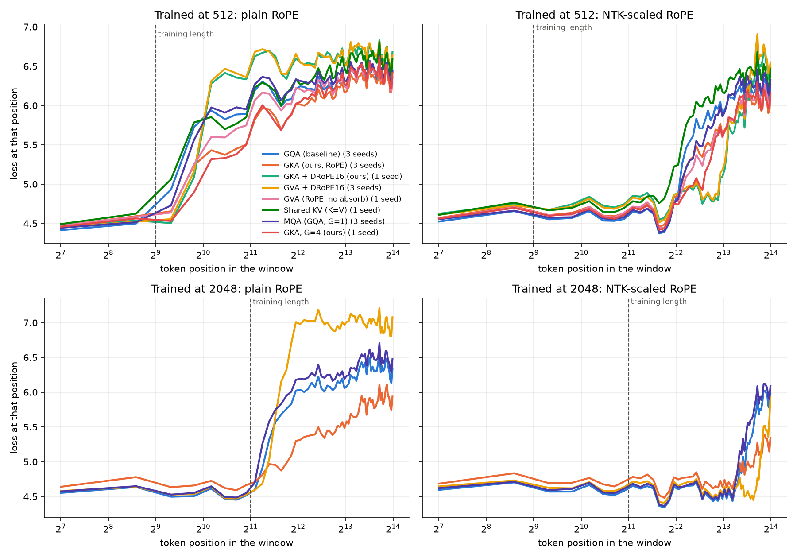

# Long-context evaluation

Held-out FineWeb-Edu loss (lower is better) when running models beyond their training context. **plain** = RoPE as trained; **NTK** = inference-time NTK-aware RoPE scaling with factor context/training length. Mean ± std across seeds.

## Trained at 512 tokens

| Model | Seeds | plain @512 | plain @1024 | plain @2048 | plain @4096 | plain @8192 | plain @16384 | NTK @1024 | NTK @2048 | NTK @4096 | NTK @8192 | NTK @16384 |
|---|---|---|---|---|---|---|---|---|---|---|---|---|
| GQA (baseline) | 3 | 4.434 ± 0.003 | 4.873 ± 0.046 | 5.402 ± 0.069 | 5.774 ± 0.069 | 6.028 ± 0.056 | 6.208 ± 0.037 | 4.508 ± 0.030 | 4.800 ± 0.052 | 5.135 ± 0.058 | 5.399 ± 0.058 | 5.660 ± 0.048 |
| GKA (ours, RoPE) | 3 | 4.515 ± 0.014 | 4.719 ± 0.059 | 5.097 ± 0.109 | 5.489 ± 0.088 | 5.812 ± 0.065 | 6.069 ± 0.053 | 4.523 ± 0.012 | 4.687 ± 0.048 | 4.948 ± 0.078 | 5.212 ± 0.077 | 5.507 ± 0.060 |
| GKA + DRoPE16 (ours) | 1 | 4.470 | 4.609 | 5.510 | 6.034 | 6.326 | 6.481 | 4.450 | 4.470 | 4.728 | 5.094 | 5.485 |
| GVA + DRoPE16 | 3 | 4.468 ± 0.006 | 4.639 ± 0.028 | 5.550 ± 0.010 | 6.063 ± 0.017 | 6.345 ± 0.024 | 6.491 ± 0.031 | 4.455 ± 0.015 | 4.485 ± 0.028 | 4.755 ± 0.024 | 5.127 ± 0.031 | 5.538 ± 0.033 |
| GVA (RoPE, no absorb) | 1 | 4.517 | 4.722 | 5.221 | 5.651 | 5.972 | 6.172 | 4.516 | 4.671 | 4.940 | 5.218 | 5.508 |
| Shared KV (K=V) | 1 | 4.551 | 4.965 | 5.407 | 5.797 | 6.106 | 6.341 | 4.634 | 4.922 | 5.303 | 5.595 | 5.882 |
| MQA (GQA, G=1) | 3 | 4.455 ± 0.009 | 4.800 ± 0.044 | 5.409 ± 0.030 | 5.828 ± 0.031 | 6.090 ± 0.039 | 6.259 ± 0.051 | 4.479 ± 0.022 | 4.709 ± 0.059 | 5.056 ± 0.063 | 5.367 ± 0.049 | 5.653 ± 0.041 |
| GKA, G=4 (ours) | 1 | 4.491 | 4.585 | 4.986 | 5.432 | 5.812 | 6.116 | 4.480 | 4.568 | 4.814 | 5.131 | 5.466 |

## Trained at 2048 tokens

| Model | Seeds | plain @512 | plain @1024 | plain @2048 | plain @4096 | plain @8192 | plain @16384 | NTK @4096 | NTK @8192 | NTK @16384 |
|---|---|---|---|---|---|---|---|---|---|---|
| GQA (baseline) | 3 | 4.560 ± 0.009 | 4.515 ± 0.008 | 4.490 ± 0.008 | 5.008 ± 0.031 | 5.567 ± 0.021 | 5.931 ± 0.010 | 4.504 ± 0.007 | 4.686 ± 0.007 | 4.934 ± 0.035 |
| GKA (ours, RoPE) | 3 | 4.686 ± 0.029 | 4.657 ± 0.034 | 4.641 ± 0.038 | 4.818 ± 0.084 | 5.125 ± 0.106 | 5.476 ± 0.118 | 4.648 ± 0.042 | 4.727 ± 0.064 | 4.854 ± 0.080 |
| GVA + DRoPE16 | 3 | 4.579 ± 0.017 | 4.534 ± 0.019 | 4.505 ± 0.021 | 5.173 ± 0.001 | 6.108 ± 0.038 | 6.538 ± 0.052 | 4.502 ± 0.023 | 4.550 ± 0.019 | 4.734 ± 0.022 |
| MQA (GQA, G=1) | 3 | 4.585 ± 0.022 | 4.541 ± 0.025 | 4.517 ± 0.027 | 5.126 ± 0.142 | 5.712 ± 0.130 | 6.062 ± 0.121 | 4.560 ± 0.051 | 4.766 ± 0.122 | 5.024 ± 0.155 |

