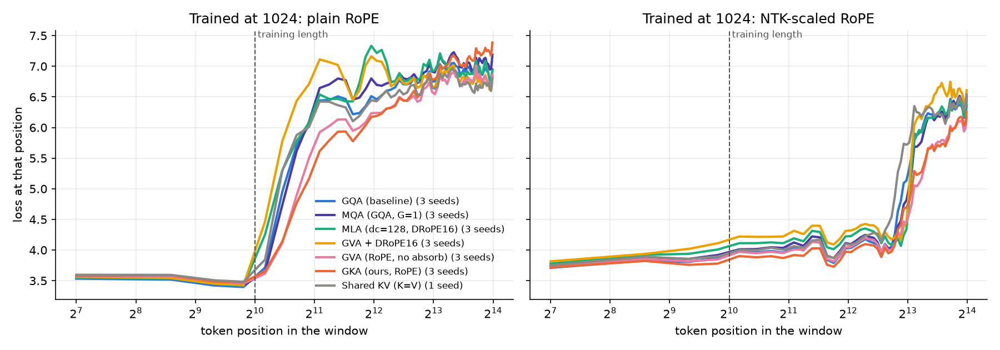

# Long-context evaluation

Held-out FineWeb-Edu loss (lower is better) when running models beyond their training context. **plain** = RoPE as trained; **NTK** = inference-time NTK-aware RoPE scaling with factor context/training length. Mean ± std across seeds.

## Trained at 1024 tokens

| Model | Seeds | plain @1024 | plain @2048 | plain @4096 | plain @8192 | plain @16384 | NTK @2048 | NTK @4096 | NTK @8192 | NTK @16384 |
|---|---|---|---|---|---|---|---|---|---|---|
| GQA (baseline) | 3 | 3.456 ± 0.004 | 4.295 ± 0.059 | 5.367 ± 0.064 | 6.047 ± 0.066 | 6.477 ± 0.036 | 3.504 ± 0.017 | 3.961 ± 0.043 | 4.557 ± 0.070 | 5.137 ± 0.077 |
| MQA (GQA, G=1) | 3 | 3.480 ± 0.008 | 4.268 ± 0.186 | 5.478 ± 0.054 | 6.157 ± 0.033 | 6.599 ± 0.070 | 3.504 ± 0.019 | 3.924 ± 0.157 | 4.523 ± 0.191 | 5.130 ± 0.145 |
| MLA (dc=128, DRoPE16) | 3 | 3.471 ± 0.010 | 4.414 ± 0.085 | 5.568 ± 0.033 | 6.250 ± 0.036 | 6.588 ± 0.063 | 3.565 ± 0.033 | 3.918 ± 0.064 | 4.520 ± 0.053 | 5.152 ± 0.056 |
| GVA + DRoPE16 | 3 | 3.485 ± 0.011 | 4.685 ± 0.116 | 5.797 ± 0.070 | 6.316 ± 0.024 | 6.549 ± 0.011 | 3.623 ± 0.058 | 4.062 ± 0.110 | 4.698 ± 0.085 | 5.326 ± 0.065 |
| GVA (RoPE, no absorb) | 3 | 3.504 ± 0.004 | 4.000 ± 0.051 | 5.054 ± 0.049 | 5.761 ± 0.026 | 6.264 ± 0.089 | 3.505 ± 0.003 | 3.768 ± 0.034 | 4.277 ± 0.048 | 4.868 ± 0.045 |
| GKA (ours, RoPE) | 3 | 3.518 ± 0.006 | 3.957 ± 0.104 | 4.942 ± 0.076 | 5.720 ± 0.067 | 6.419 ± 0.126 | 3.527 ± 0.004 | 3.802 ± 0.055 | 4.288 ± 0.108 | 4.864 ± 0.088 |
| GKA + cross-group V | 3 | 3.507 ± 0.005 | 4.128 ± 0.141 | 5.057 ± 0.164 | 5.803 ± 0.139 | 6.391 ± 0.196 | 3.548 ± 0.025 | 3.956 ± 0.099 | 4.475 ± 0.116 | 5.033 ± 0.123 |
| GKA + rotated V | 3 | 3.546 ± 0.006 | 4.215 ± 0.065 | 5.441 ± 0.160 | 6.216 ± 0.151 | 6.741 ± 0.153 | 3.553 ± 0.004 | 3.887 ± 0.039 | 4.516 ± 0.045 | 5.143 ± 0.040 |
| GKA + cross-group + rotated V | 3 | 3.515 ± 0.007 | 4.339 ± 0.108 | 5.428 ± 0.063 | 6.101 ± 0.015 | 6.555 ± 0.057 | 3.537 ± 0.006 | 3.974 ± 0.120 | 4.626 ± 0.100 | 5.209 ± 0.060 |
| Shared KV (K=V) | 1 | 3.534 | 4.395 | 5.364 | 5.988 | 6.359 | 3.651 | 4.189 | 4.748 | 5.282 |

